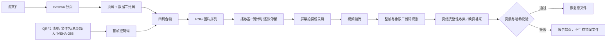

# 系统架构与传输可靠性说明

更新日期：2026-11-12。本文按当前代码描述系统现状，并区分实现行为、约束和实测结果。二维码识别最终仍受显示器、相机、对焦、运动模糊和视频压缩影响；代码逻辑不能保证每次拍摄都收齐全部页。

## 1. 系统概览

本项目是 Java 8、Maven、Swing 桌面程序，没有服务端。文件经 Base64 分页后编码为二维码，通过屏幕显示和相机拍摄完成光学传输。



核心模块：

| 模块 | 主要职责 |
| --- | --- |
| `demo/FileTransferApp` | Swing 工作台、文件选择、进度与结果目录入口、使用说明及配置 |
| `utils/FileConvertUtil` | 单码图片读写、Base64 分页、恢复文件、页数与清单校验 |
| `utils/FourQrFrameComposer` | 生成四码合图与首帧控制码；逐帧保存 PNG，不生成 MP4 |
| `utils/TransferManifest` | `QRF2` 清单解析、原文件名、安全字段与 SHA-256 校验 |
| `utils/PageCollector` | 页号校验、去重、冲突统计、多码帧按连续页组原子接收 |
| `utils/QRCodeUtil*` | ZXing、BoofCV、OpenCV 等二维码识别适配和象限裁剪 |
| `utils/VideoQrDecoder`、`utils/FFmpegUtil` | FFmpeg 流式抽帧、识别、阶段进度、补采和恢复结果保存 |
| `demo/QrImagePlayerFrame` | 图片预加载、3 秒倒计时、完整停留计时、播放速度调整及结束提示 |

## 2. 协议与容量

每个数据页沿用旧文本协议：4 位十进制页号 + 最多 1020 个 Base64 字符。文件按原字节 Base64 编码，另有 10 个字符的扩展名字段。新版清单采用 `QRF2` 控制记录，提供总页数、文件大小、SHA-256 和原文件名；数据页本身继续沿用旧格式，便于新接收端读取旧版页面。

在此分页规则下，原文件大小为 `S` 字节时，页数约为：

```text
ceil((4 × ceil(S / 3) + 10) / 1020)
```

例如 1 MiB 文件为 1,371 页；7 MiB 上限约为 9,600 页，低于页号最多 10,000 页的协议边界。页面每组 4 页排成 2×2；因此 1 MiB 大约需要 343 张数据帧图片，另有清单控制帧。合帧减少显示/拍摄画面数，不改变数据页数量，且每个码的成像尺寸变小，拍摄难度可能增加。

当前发送和恢复路径会把整个文件读入内存。7 MiB 上限降低了单文件内存压力，但生成时还要保存二维码/合成图片，视频识别也会并行处理帧，因此实际峰值内存高于源文件大小。

新版接收端兼容旧协议单码图片和视频，也可处理新版四码图像/视频；旧版接收端无法识别四码合图。旧协议没有清单和文件级哈希，无法提供新版同等的完整性确认。缺页、清单页数不符或 SHA-256 校验失败时，新协议不会产出恢复成功文件。

## 3. 发送、存储与播放

1. `FileTransferApp` 检查文件类型为普通文件且不超过 7 MiB。
2. `FourQrFrameComposer` 通过文件转换逻辑生成数据页二维码，并写出 `transfer_manifest.txt`；源文件名、时间戳组成源文件同级输出目录名。
3. 输出为 1080×1080 PNG 序列，每帧最多 4 个 500×500 二维码，四角含定位标记。首帧以清单码占一个象限并重复展示第 0 页，后续数据帧按连续页分组，末帧允许不足 4 页。
4. 播放器开始前展示 3 秒倒计时。默认停留 200 毫秒，可配置范围 200–10,000 毫秒；下一张图片预先解码，当前帧的计时从绘制显示后开始。若加载或界面处理较慢，当前帧延长显示，不以跳帧追赶时钟。
5. 播放帧率只是播放器计划值。显示器刷新率、操作系统调度、屏幕录制帧率和相机快门会影响实际拍到的帧；200 毫秒配置不能单独证明拍摄端完整记录了每张图。

生成图像保存在所选源文件同级目录，命名为“源文件名前缀_时间戳”。四码图像生成流程不输出中间单码 PNG，也不生成视频文件。

## 4. 图片与视频接收链路

### 图片

图片恢复目录由用户选择。新协议单码二维码目录须保留 `transfer_manifest.txt`；视频恢复保存的 `recognized_qr` 目录包含已识别二维码及所需清单，可再次通过图片恢复入口处理。

### 视频

- FFmpeg 通过管道把 RGB 帧送入内存，不把全部视频帧拆成临时 PNG。首轮按 30 fps 采样，并根据视频原生帧率提高采样值，最高 60 fps；首轮对宽图可缩至最多 1152 像素宽，后续精修/补采使用原始分辨率。
- 识别使用有界帧队列和有限线程池；重复画面会跳过部分解码。识别结果连同页号首次/末次出现时间记录下来，供缺页定位。
- 多码帧优先整体解码；缺页补采时也扫描整帧和重叠四象限，并调用单码识别逻辑。四码组按连续页号聚合，在一个候选帧里只有预期页组完整时才一起接收，避免把不同帧的零散部分凑成一个看似完整的组。
- 清单给出总页数后，页组预期大小按 4 页计算，首尾不足 4 页时按实际剩余页数处理。没有清单的旧协议只能依据已观察到的页码判断中间缺页，无法可靠推断未拍到的末尾页数。
- 补采范围由缺页组两侧最近已识别页的时间点确定；两侧锚点齐全时扫描其间完整时间段并留边界余量。视频开头或结尾没有一侧锚点时采用最多 3 秒的边缘窗口；若视频本身存在长停顿或缺页离相邻锚点很远，这个限制可能覆盖不到全部候选帧。常规窗口仍未恢复时，代码会再均匀抽最多 30 帧做重型识别。
- 补采会对同一缺页组跨候选帧累计识别结果，并在满足组完整与内容一致性条件时收集；无法形成完整预期页组时保持缺失，不拼接不完整数据。
- 输出目录在视频同级，按原视频名和时间戳命名，内含恢复文件、`recognized_qr`、`missing_pages.txt` 等结果。实际内容以运行生成的清单为准。

## 5. 进度、耗时和可诊断性

视频进度按扫描、精修、补采、保存识别二维码、校验与生成文件分阶段汇报。首轮需累积一定帧数后才显示速度估算；补采阶段根据窗口时长和首轮扫描耗时估算。恢复二维码保存也单独报告已完成张数和本阶段预估。最终耗时覆盖扫描、补采、恢复二维码保存及文件校验。

估算会受机器 CPU、视频编码、分辨率、识别引擎回退次数、缺页窗口数量和磁盘速度影响；阶段动态变化时剩余时间会修正，不是完成时间保证。诊断输出应重点记录页号、帧时间、页组范围、解码路径、补采范围和最终哈希结果；识别出的完整 Base64 文件内容不应写入日志。

## 6. 已知限制与正确解释

- “缺页”表示算法本次没有得到可通过校验的页内容；原因可能是没拍到、模糊/压缩、翻页或显示器撕裂，也可能是识别路线没解出。单凭缺页结果不能区分这些原因。
- 四页一组的原子收集减少组内错位，但也意味着一个象限持续无法识别时，该组可能整体暂不接收；补采需找出同一组的完整有效结果。
- 四码图更紧凑，但相同总二维码模块显示面积会被分成四份。传输总时间取决于一组画面停留、重试和成功率，不应简单按“四倍码”推断提速倍数。
- 视频抽样率最高 60 fps；高于此值的视频不能保证每个原生帧都采样。常规首轮宽度缩放也可能导致漏检，所以有缺页时会尝试原分辨率阶段。
- 3 秒边缘补采策略是时间窗口上限，不是对无限长视频首尾片段的完整覆盖保证。
- 播放器确保本地界面不主动缩短已显示帧的计时；不能确保外部拍摄设备真的记录到每帧。

## 7. 近期针对随机缺页的改进

用户报告同一视频多次处理结果不一致。相关路径重点检查并修复了这些问题：

1. 识别引擎可能返回不可变单元素列表，补采合并结果时若直接修改会抛 `UnsupportedOperationException` 并中断窗口；视频补采现已先复制结果再合并。
2. 原分辨率精修后仍有少量缺页时，确保继续调用定向补采，而非跳过补采。
3. 对四码画面增加象限级解码；补采阶段按候选帧对页组累计识别并检查组完整性。
4. 进度中明确显示缺页页号/页组、补采窗口、帧率和原始分辨率，完成后列出仍未识别页及恢复产物位置。

这些修正降低了代码异常导致的随机中断，并扩大了候选二维码识别路径；不能消除拍摄输入中的真实缺帧、模糊或压缩损失。

## 8. 验证记录与范围

本轮开发过程中执行过 `mvn clean package -q`：构建成功，20 个测试通过；`git diff --check` 通过（仅报告换行符提示）。另对一段约 24.7 秒、1920×1080、30 fps 的视频执行过一次端到端回归：修复后的版本识别 244/244 页，恢复文件 SHA-256 与源文件一致，总耗时约 68 秒。该视频和机器是单次样本，数据仅证明该次回归成功，不能代表其他设备、视频或一般性能。

回归测试之前，同一素材曾出现若干四页组漏页；截图检查在组 68、84、232 的样本时间点发现整帧路线只能识别 3 页，而四象限路线能解出 4 页。这说明象限扫描对该素材有帮助，不构成所有缺页都能恢复的统计结论。

## 9. 文件大小与时间估算

1 MiB 文件约 1,371 个逻辑数据页、约 343 张四码数据帧，另有清单控制帧。按每帧 200 毫秒计算，理想本地播放约 69 秒；这只是图像播放时长，不包括生成、拍摄准备、视频扫描、补采和失败重试，也不保证相机完整捕获。实际所需时间应以设备端到端实测为准。
